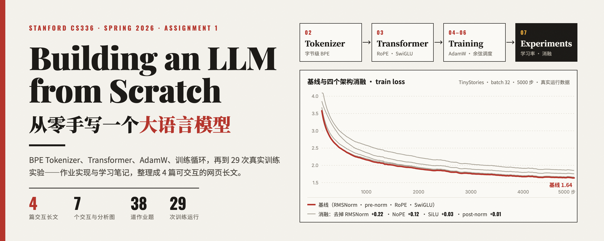
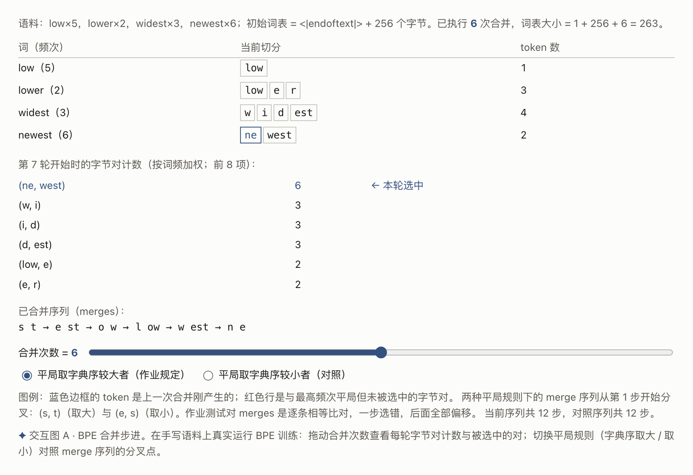
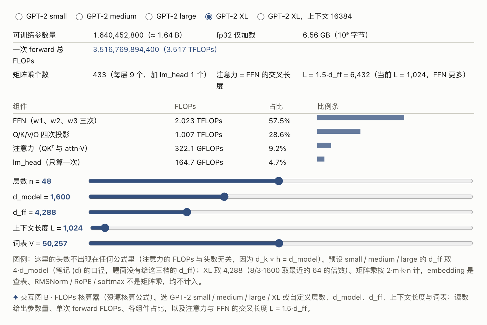
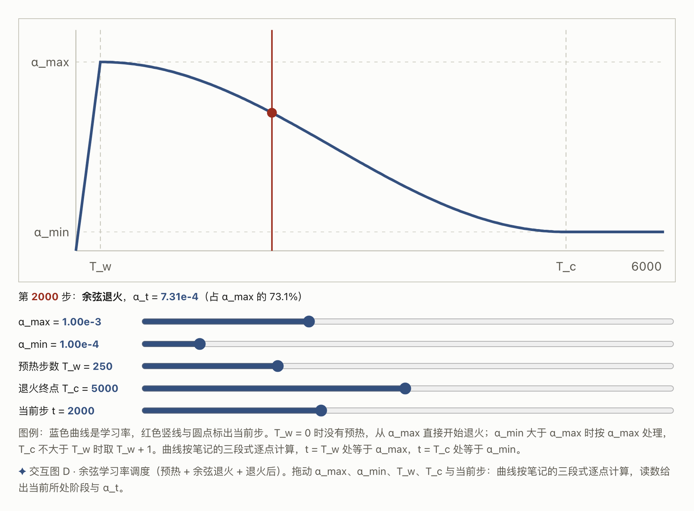
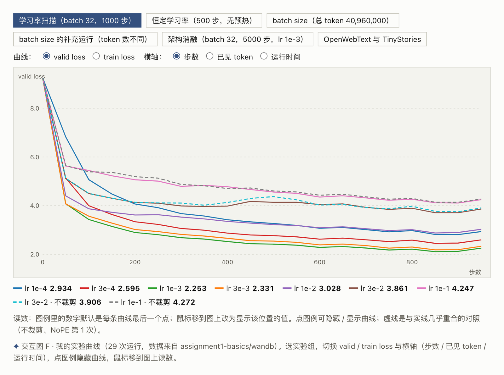

<div align="center">



# CS336 Assignment 1 · Building an LLM from Scratch
### 从零手写一个大语言模型

**BPE Tokenizer · Transformer · AdamW · Training Loop · 29 Experiments**<br>
**BPE 分词器 · Transformer · AdamW · 训练循环 · 29 次实验**

*斯坦福 CS336 (basics) 的作业实现，与整理成 4 篇可交互网页的学习笔记*<br>
*Stanford CS336 (basics) assignment implementation, with notes written up as 4 interactive web articles*


</div>

---

> **读者不需要装任何环境**：`site/` 下的 4 篇文章是单文件 HTML，双击即读，离线可用。
> 代码、测试与 29 次实验的原始 wandb 记录都在 `assignment1-basics/`。

## 文章

| | |
|---|---|
| [](site/02-tokenizer.html) | [](site/03-transformer.html) |
| **[第 2 章 · 从字节到 token](site/02-tokenizer.html)**<br>BPE 训练与编码；上图：在手写语料上逐步运行 BPE，看每一轮的字节对计数和被选中的对 | **[第 3 章 · 从零搭 Transformer](site/03-transformer.html)**<br>einsum 手搭 RMSNorm / RoPE / SwiGLU；上图：GPT-2 各尺寸的参数量与 FLOPs 分解 |
| [](site/04-06-training.html) | [](site/07-experiments.html) |
| **[第 4–6 章 · 训练](site/04-06-training.html)**<br>交叉熵、AdamW、调度、裁剪、解码；上图：预热 + 余弦退火的学习率调度 | **[第 7 章 · 实验](site/07-experiments.html)**<br>29 次训练运行；上图：学习率扫描的 valid loss 曲线（还可切换 batch、消融等 6 组） |

每篇都配有 5 个交互图（BPE 合并步进、FLOPs 核算器、SGD 学习率、余弦调度、参数预算）与 2 张实验分析图；题目可折叠，“我的回答”点击展开。

## 实验主要结论

| 问题 | 结论 |
|---|---|
| 学习率 | 最优约 **1e-3**，位于“稳定边缘”内侧一档；无预热时大学习率头几步即爆 |
| batch size | 固定 token 预算下 **batch 16–32** 最好；64 以内可用“batch 翻倍、lr 翻倍”补偿 |
| 架构消融 | 均差于基线：去 RMSNorm **+0.22** ＞ NoPE **+0.12** ＞ SiLU **+0.026** ＞ post-norm **+0.013** |
| OpenWebText | 同配置 valid **4.54**：每字节约 1.49 比特（TinyStories 0.58），loss 仍在下降 |

## 仓库结构

```
├── site/                        # 4 篇文章 + 导航页 + 信息卡（GitHub Pages 可直接用）
│   ├── index.html
│   ├── 02-tokenizer.html … 07-experiments.html
│   ├── shots/                   # README 里的交互图截图
│   └── promo/                   # hero 图与信息卡（含 HTML 源文件）
└── assignment1-basics/          # 完整代码与实验记录
    ├── cs336_basics/            # 全部实现（_01–_26：BPE → Transformer → 训练 → 实验）
    ├── tests/                   # 课程测试 + 适配器（fixtures 为快照数据）
    ├── wandb/                   # 29 次训练运行的原始记录（第 7 章数据的出处）
    ├── *.pkl                    # 训练好的 tokenizer 词表（TinyStories 10K / OWT 32K）
    └── *.log                    # BPE 与训练日志
```

## 复现

```bash
cd assignment1-basics
uv sync                      # 安装依赖
uv run pytest tests/test_train_bpe.py tests/test_tokenizer.py      # tokenizer
uv run pytest tests/test_model.py tests/test_nn_utils.py tests/test_optimizer.py
uv run python cs336_basics/_25_train_experiment.py --help           # 第 7 章实验脚本
```

> 为控制体积，仓库不含 `data/`、`ckpt/`、`*.bin`、`.venv`（合计约 34G，可按文章第 1–2 章的流程重新生成）。

<details>
<summary><b>附：实现中遇到的一个 bug（梯度裁剪没有生效）</b></summary>

训练脚本把 `model.parameters()`（生成器）传给了梯度裁剪函数，而裁剪需要**两次**遍历参数（先算全局范数、再缩放）——生成器第二次遍历为空，**裁剪在所有 29 次运行里都没有生效**。单元测试传的是元组，所以测不出来。

```python
def gradient_clipping(parameters, max_norm, eps=1e-6):
    parameters = list(parameters)   # ← 修复：先物化，生成器只能消费一次
    ...
```

详见 [第 4–6 章的校注](site/04-06-training.html)与第 7 章“裁剪 / 不裁剪两组为什么重合”的分析。

</details>

## 说明

- 本人以自学方式学习该课程（非选课学生）；作业框架来自公开仓库 [stanford-cs336/assignment1-basics](https://github.com/stanford-cs336/assignment1-basics)，其版权与许可见 [`assignment1-basics/LICENSE`](assignment1-basics/LICENSE)，`cs336_basics/` 下的实现为本人所写。
